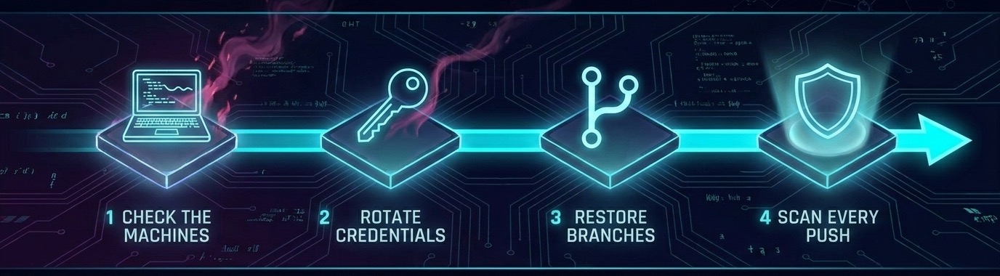

import { Card, CardGrid } from '@astrojs/starlight/components';
import { ContainerSection } from 'lucode-starlight/components';

<ContainerSection width="lg">

<ul class="badges">
<li><a href="https://github.com/meSingh/polinrider-cleaner/actions/workflows/ci.yml"></a></li>
<li><a href="https://scorecard.dev/viewer/?uri=github.com/meSingh/polinrider-cleaner"></a></li>
<li><a href="https://github.com/meSingh/polinrider-cleaner/actions/workflows/codeql.yml"></a></li>
<li><a href="https://github.com/meSingh/polinrider-cleaner/commits/main"></a></li>
<li><a href="https://github.com/meSingh/polinrider-cleaner/releases/latest"></a></li>
<li><a href="/polinrider-cleaner/indicator-reviews/"></a></li>
<li></li>
</ul>

</ContainerSection>

<ContainerSection width="md">

## One program

Download it for macOS, Linux or Windows, verify it, and run it. It asks what
you need, one question at a time, and changes nothing until you type `yes`.

```bash
./polinrider
```

[Download and verify](/polinrider-cleaner/quick-start/)

<div style="text-align:center; margin: 2.5rem 0 1rem;">
<span class="figure">267 days</span>
<span class="figure-note">of backdating on one documented commit. <code>git log</code> showed nothing.</span>
</div>

</ContainerSection>

<ContainerSection width="md">

## Why a tool rather than a checklist

A script on the infected machine reads your last commit's timestamp, winds the
system clock back to it, amends that commit with the payload, restores the
clock, and force-pushes. What lands is a commit with an ordinary date and your
name on it.

Detection has to be content scanning of every ref, reconciled against push
events. Nobody does that by eye across fifty repositories.

</ContainerSection>

<ContainerSection width="lg">

<CardGrid>
  <Card title="A machine" icon="laptop">
    Second-stage implant, editor extensions, tasks that run on folder open,
    build configs, fake fonts, persistence, credentials.
    [Check a machine](/polinrider-cleaner/guides/machine/)
  </Card>
  <Card title="A GitHub account" icon="github">
    Every repository, every branch and tag, read against GitHub's push record.
    Restores branches where the evidence survived.
    [Clean an account](/polinrider-cleaner/guides/account/)
  </Card>
  <Card title="An organization" icon="setting">
    The same check across every repository an org owns, then one repository
    at a time or one fix for all of them.
    [Clean an organization](/polinrider-cleaner/guides/organization/)
  </Card>
  <Card title="Every future push" icon="approve-check">
    A scanner you copy into your own repository. No third-party action, nothing
    leaves your infrastructure.
    [Set up CI](/polinrider-cleaner/guides/ci/)
  </Card>
</CardGrid>

</ContainerSection>

<ContainerSection width="md">

## Clean up in this order



Cleaning GitHub while an infected machine still holds a valid token undoes
the work within minutes. [Why the order is fixed](/polinrider-cleaner/guides/order/)

</ContainerSection>

<ContainerSection width="md">

## What it will not do

A tool you run during an incident should be honest about its limits.

- It **cannot prove you are clean.** A clean result means the current indicator
  set is absent. Signatures rotate. Rotate your credentials regardless.
- It **does not make a compromised machine trustworthy again.** Quarantining
  files is containment; rebuilding from a clean OS install is recovery.
- It **changes nothing unless you tell it to.** Every destructive step is a dry
  run first. Nothing is deleted: a confirmed artifact is moved to quarantine,
  and where a payload was appended to a build config, `clean` cuts it out in
  place and keeps the infected original in quarantine. On GitHub, each fix
  shows what it would change and pushes only when you type `yes`.

## Why you can run this

You are being asked to run unknown code on a machine you may believe is
compromised. That deserves evidence rather than a promise.

| | |
|---|---|
| **Built during a real incident** | 57 repositories and 304 refs on the author's own account. Two of ten restore points turned out to be infected themselves |
| **Indicators reviewed weekly** | Every review [logged, including the weeks nothing changed](/polinrider-cleaner/indicator-reviews/) |
| **Every commit signed** | The direct counter to the campaign's own backdated-amend technique |
| **Releases carry provenance** | A sigstore attestation proves each binary came from this repository's CI |
| **It scans itself** | CI fails if the repository matches its own indicators once its detection code is excluded |

[How to verify all of that yourself](/polinrider-cleaner/reference/verifying/)

</ContainerSection>
